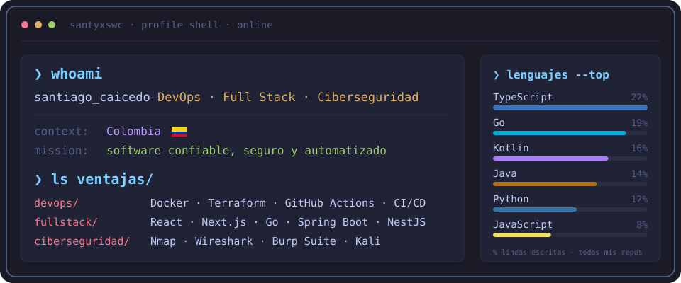
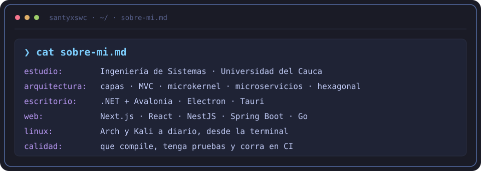

  <a href="https://github.com/santyxswc">
    <picture>
      <source media="(prefers-color-scheme: dark)" srcset="assets/banner-dark.svg"/>
      <source media="(prefers-color-scheme: light)" srcset="assets/banner-light.svg"/>
      
    </picture>
  </a>

  

  
  
  

## `$ whoami`

  <picture>
    <source media="(prefers-color-scheme: dark)" srcset="assets/whoami-dark.svg"/>
    <source media="(prefers-color-scheme: light)" srcset="assets/whoami-light.svg"/>
    
  </picture>

## `$ cat sobre-mi.md`

  <picture>
    <source media="(prefers-color-scheme: dark)" srcset="assets/sobre-mi-dark.svg"/>
    <source media="(prefers-color-scheme: light)" srcset="assets/sobre-mi-light.svg"/>
    
  </picture>

## `$ ls ~/proyectos`

<table>
  <thead>
    <tr>
      <th colspan="2" align="left"><code>santyxswc:~$ ls -la ~/proyectos</code></th>
    </tr>
  </thead>
  <tbody>
    <tr>
      <td colspan="2" valign="top">
        <code>├─ 🎬 </code><a href="https://github.com/santyxswc/streaming-Sntx"><code>streaming-Sntx/</code></a> · <a href="https://streaming-sntx.vercel.app">ver en vivo ↗</a>  
        Catálogo de <b>más de 100.000 películas y series</b> para descubrir títulos por sus tráilers oficiales,
        con <b>búsqueda en lenguaje natural asistida por IA</b>, listas personales y chat por título.
        Tiene app web y cliente de escritorio que consumen la misma API.  
        
        
        
        
        
        
        
      </td>
    </tr>
    <tr>
      <td width="50%" valign="top">
        <code>├─ 💊 </code><a href="https://github.com/santyxswc/FarmaciaApp"><code>FarmaciaApp/</code></a>  
        
        
Gestión de una farmacia: ventas con facturación, inventario, clientes, proveedores, promociones y turnos de empleados. Multiplataforma.

        
        
        
        
      </td>
      <td width="50%" valign="top">
        <code>├─ 🃏 </code><a href="https://github.com/santyxswc/BlackJack-CS"><code>BlackJack-CS/</code></a>  
        
        
Blackjack de escritorio contra la banca, con cuentas de jugador que guardan saldo y estadísticas entre partidas. Windows, Linux y macOS.

        
        
        
      </td>
    </tr>
    <tr>
      <td width="50%" valign="top">
        <code>├─ 🏥 </code><a href="https://github.com/santyxswc/CuadroDeTurnos"><code>TurnoCare/</code></a>  
        
Aplicación de escritorio para que un equipo de enfermería maneje su cuadro de turnos, marcaciones, horas diurnas/nocturnas, recargos, vacaciones y chat del equipo. Motor de reglas en TypeScript puro con pruebas.

        
        
        
        
      </td>
      <td width="50%" valign="top">
        <code>├─ 📝 </code><a href="https://github.com/santyxswc/Banco_preguntas-ISoftII"><code>Banco_preguntas/</code></a>  
        
Proyecto en equipo: gestión, validación estructural y revisión por pares de preguntas tipo Saber Pro. Evoluciona de monolito en capas (MVC) a microservicios con eventos y arquitectura hexagonal.

        
        
        
        
         
        
      </td>
    </tr>
  </tbody>
  <tfoot>
    <tr>
      <td colspan="2">
        <code>╰─ otros:</code>
        <a href="https://github.com/santyxswc/Lab_ing_softwareII"><code>Lab_ing_softwareII</code></a> (microkernel + tuberías y filtros, API REST con Spring Boot) ·
        <a href="https://github.com/santyxswc/ArquitecturaComputacional"><code>ArquitecturaComputacional</code></a> (control de acceso y ambiental) ·
        <a href="https://github.com/santyxswc/almacen-c"><code>almacen-c</code></a> (POO en C++)
      </td>
    </tr>
  </tfoot>
</table>

## `$ cat tech-stack.yaml`

<table>
  <thead>
    <tr>
      <th colspan="2" align="left"><code>santyxswc:~$ cat tech-stack.yaml</code></th>
    </tr>
  </thead>
  <tbody>
    <tr>
      <td width="50%" valign="top"><code>├─ ✦ lenguajes:</code>  
         
         
        <code>TypeScript · Go · Kotlin · Java · Python · JavaScript · C# · C++ · C · Bash</code>
      </td>
      <td width="50%" valign="top"><code>├─ ◧ frontend_escritorio:</code>  
         
         
        <code>Next.js · React · Tailwind · Vite · Electron · Tauri · Avalonia</code>
      </td>
    </tr>
    <tr>
      <td valign="top"><code>├─ ⚙ backend:</code>  
         
        <code>Go (chi) · Spring Boot · NestJS · Node.js · .NET</code>
      </td>
      <td valign="top"><code>├─ ▣ datos:</code>  
         
        <code>PostgreSQL · MySQL · Oracle · Firebase</code>
      </td>
    </tr>
    <tr>
      <td valign="top"><code>├─ ☁ devops:</code>  
         
        <code>Docker · Terraform · GitHub Actions · Vercel · Git · Vitest</code>
      </td>
      <td valign="top"><code>╰─ ⌁ seguridad_sistemas:</code>  
         
        <code>Arch · Kali · Nmap · Wireshark · Burp Suite</code>
      </td>
    </tr>
  </tbody>
  <tfoot>
    <tr>
      <td colspan="2"><code>editores: IntelliJ IDEA · VS Code&nbsp;&nbsp;·&nbsp;&nbsp;shell: zsh&nbsp;&nbsp;·&nbsp;&nbsp;os: arch linux</code></td>
    </tr>
  </tfoot>
</table>

## `$ git log --stats`

  <picture>
    <source media="(prefers-color-scheme: dark)" srcset="https://raw.githubusercontent.com/santyxswc/santyxswc/actividad/actividad-dark.svg"/>
    <source media="(prefers-color-scheme: light)" srcset="https://raw.githubusercontent.com/santyxswc/santyxswc/actividad/actividad-light.svg"/>
    
  </picture>

  <picture>
    <source media="(prefers-color-scheme: dark)" srcset="https://raw.githubusercontent.com/santyxswc/santyxswc/actividad/calendario-dark.svg"/>
    <source media="(prefers-color-scheme: light)" srcset="https://raw.githubusercontent.com/santyxswc/santyxswc/actividad/calendario-light.svg"/>
    
  </picture>

  

  <picture>
    <source media="(prefers-color-scheme: dark)" srcset="https://raw.githubusercontent.com/santyxswc/santyxswc/output/github-snake-dark.svg"/>
    <source media="(prefers-color-scheme: light)" srcset="https://raw.githubusercontent.com/santyxswc/santyxswc/output/github-snake.svg"/>
    
  </picture>

<code>santyxswc@arch:~$ exit</code>&nbsp;&nbsp;·&nbsp;&nbsp;hecho desde Colombia 🇨🇴

